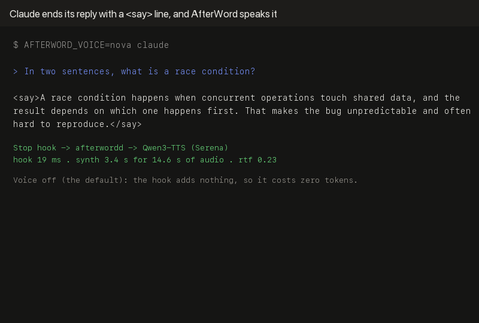

# AfterWord

Spoken replies for Claude Code, with local Qwen3-TTS on Apple Silicon.
Speech is **off by default**, **set per session**, and **triggered only by a tag**
in Claude's reply. See [DESIGN.md](DESIGN.md).



Status: the v1 build order is done: tag parser, hooks (`SessionStart`,
`UserPromptSubmit`, `Stop`) with a `say` fallback, the daemon (queue, event log,
Qwen3-TTS through mlx-audio), the voice command, the Claude Code plugin, and the GUI
(log, sessions, queue, history, voice lab, config). Not built: the optional
menu-bar icon.

## How it works

While a session's voice is on, a `UserPromptSubmit` hook adds about 40 tokens
to each prompt asking Claude to end its reply with a spoken summary:

```
<say mood="dry" lang="en" pace="1.1">one or two sentences</say>
```

With the voice off (the default) the hook adds nothing, so it costs zero tokens.
The `Stop` hook reads the reply and sends the `<say>` text to the daemon over
`~/.afterword/afterword.sock`, which renders it with the session's voice profile
and plays it. If the daemon is down, the hook speaks with `say` directly
(`fallback = "none"` turns that off). If Qwen3-TTS cannot render a line (model
missing, bad voice), the daemon speaks it with `say` and notes why in the log.
Tags inside code blocks, inline code and HTML comments are ignored.

Turn the voice on for a session:

- at launch: `AFTERWORD_VOICE=nova claude` (the `SessionStart` hook reads it);
- mid-session: `/afterword:voice nova` with the plugin, or `/afterword-voice nova`
  with `install-hooks` (not bare `/voice`: that is Claude Code's own dictation
  command). Also `off`, `on` (the last profile), `mute`, `unmute`, and no
  argument for the current state;
- in the GUI's Sessions page.

Claude can also switch it with a `<voice set="nova"/>` tag (`set="off"` to stop).

## Run it

```bash
uv sync --extra qwen
```

```bash
uv run afterword models pull
```

That downloads the three Qwen3-TTS 1.7B 8-bit models (about 3.1 GB each) into
the Hugging Face cache. `uv run afterword models list` shows what is there;
pull only `custom_voice` if you only want the built-in speakers.

```bash
uv run afterword serve
```

Open http://127.0.0.1:47800 for the live log, and http://127.0.0.1:47800/#lab
for the voice lab. Then, in another shell:

```bash
uv run afterword test "Hello from AfterWord" --profile nova --wait
```

## Voices and profiles

A profile in `~/.afterword/config.toml` picks a voice and how it speaks:

```toml
[profiles.nova]
voice = "builtin:Serena"     # see the voice kinds below
lang = "en"
pace = 1.0                   # 0.5–2.0, applied at playback, pitch kept
style = "calm, slightly wry" # style instruction (builtin and design voices)
seed = 1234                  # optional: the same line always sounds the same
max_chars = 400
say_voice = "Samantha"       # macOS voice used if Qwen3-TTS is unavailable
```

| `voice` | Model | Notes |
|---|---|---|
| `builtin:<Speaker>` | CustomVoice | Serena, Vivian, Uncle_Fu, Dylan, Eric, Ryan, Aiden, Ono_Anna, Sohee; follows `style` and `mood` |
| `clone:<clip>` | Base | clones `~/.afterword/voices/<clip>.wav`; `clone:~/path.wav` also works |
| `design:<description>` | VoiceDesign | a voice described in words; can drift between lines, so freeze one into a clip for a stable voice |
| `say:<MacVoice>` | macOS `say` | no model needed |

One voice is used for every language, so the accent stays the same.

### Voice lab

The lab (http://127.0.0.1:47800/#lab) is for trying voices and building
profiles: preview any voice with any style, mood, pace and seed; render the
same sentence in several languages to check the accent; compare two profiles
A/B; save the settings as a profile (written into `config.toml`, keeping your
comments); and manage clone clips (upload a file or record from the
microphone). To get a stable designed voice, design it, then "Freeze as clip"
and use `clone:<name>`.

Clone clips must be your own voice or a voice used with the speaker's consent;
the lab asks you to confirm this for every upload or recording.

## Hook it into Claude Code

**As a plugin (recommended).** The repository is also a Claude Code plugin
marketplace. In a terminal:

```bash
claude plugin marketplace add TonyXTYan/AfterWord
```

```bash
claude plugin install afterword@afterword
```

The plugin brings the three hooks and `/afterword:voice`. Its hooks run with
whatever `python3` is on your PATH (3.9 or newer; they use only the standard
library), so they work even before the daemon is installed: lines are then
spoken with `say`. Try it from a clone without installing:

```bash
claude --plugin-dir /path/to/AfterWord
```

**Or with settings.json.** `install-hooks` writes the same three hooks into a
settings file and an `/afterword-voice` command next to it (not for
`--scope local`). Preview the change first;
`--scope user` (default) edits `~/.claude/settings.json`, and `project` and
`local` edit `./.claude/`. A backup is written next to the file, and other hooks
are left alone.

```bash
uv run afterword install-hooks --dry-run
```

```bash
uv run afterword install-hooks
```

Use one or the other. If both are installed, each turn is still handled once
(the hooks claim each turn), but `uv run afterword install-hooks --uninstall`
removes the settings copy.

Note: `UserPromptSubmit` and `SessionStart` run synchronously (about 15-30 ms)
because their output must reach Claude before the prompt does; `Stop` runs
asynchronously. In `claude -p` (print mode) Claude Code may end before the async
`Stop` hook finishes, so a line can go unspoken there; interactive sessions are
not affected.

## The GUI

http://127.0.0.1:47800 has six pages:

- **Log**: every hook call with its raw payload, parsed tags, decision and
  reason (`session off`, `no <say> tag`, `daemon busy`, `duplicate`, …), and
  timings (hook, hook to daemon, synthesis, real-time factor, first audio),
  with p50/p95 stats. Prompt and session hooks are hidden unless you ask.
- **Sessions**: each session's folder, voice (pick a profile or off), mute,
  what set the voice, and its last line. **Mute all** sits in the header.
- **Queue**: what is playing and waiting; skip, remove or stop.
- **History**: recent spoken lines, replayable at the pace they were spoken,
  and downloadable as WAV.
- **Voice lab**: try voices and save profiles (below).
- **Config**: `config.toml` as loaded, warnings or parse errors, the synth in
  use, and model status; reload on demand.

## Files

| Path | What |
|---|---|
| `~/.afterword/config.toml` | daemon settings, `[qwen]` models, voice profiles (hot-reloaded; written on first `serve`) |
| `~/.afterword/voices/` | clone clips (`<name>.wav` + `<name>.txt` transcript) |
| `~/.afterword/lab/` | voice lab previews (cleared when the daemon restarts) |
| `~/.afterword/state/` | per-session voice state (written by the hook) |
| `~/.afterword/events.db` | event log (SQLite) shown in the UI |
| `~/.afterword/clips/` | last N spoken clips, replayable from the log |
| `~/.afterword/afterwordd.log` | daemon text log (rotating) |
| `~/.afterword/hook.log` | hook log (JSON lines; errors land here, never in Claude Code) |
| `~/.afterword/daemon.json` | daemon settings changed from the GUI (mute all) |
| `~/.afterword/seen/` | short-lived markers so each turn is handled once |

Environment: `AFTERWORD_HOME` relocates `~/.afterword`; `AFTERWORD_FALLBACK=none`
disables the `say` fallback; `AFTERWORD_DISABLE=1` makes the hook a no-op;
`AFTERWORD_SYNTH=say|null` and `AFTERWORD_PLAYER=null` override the backends.

## Development

```bash
uv run pytest -q
```

Tests that need the real models are skipped unless you opt in:

```bash
AFTERWORD_LIVE_QWEN=1 uv run pytest -q -k live
```

The hooks (`afterword/hooks/`) are stdlib-only and run on Python 3.9+, so they
work under macOS's stock `python3` as well as the project's 3.12. The plugin is
the repository root: `.claude-plugin/`, `hooks/hooks.json`, `commands/voice.md`. The tests
check this, along with the rule that the hook never fails: exit code 0, no
output, and a bounded run time for any input. The HTTP contracts are in
[docs/gui-api.md](docs/gui-api.md) and [docs/lab-api.md](docs/lab-api.md).

## Licence

MIT. Ship only built-in voices. Clone clips should come from your own voice or
a voice used with consent.
