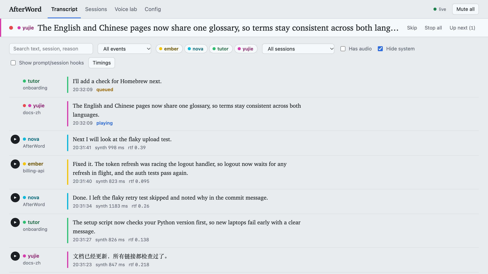

# AfterWord

Spoken replies for Claude Code (and Codex), with local TTS on Apple Silicon:
Qwen3-TTS, Kokoro, Chatterbox Multilingual, or Apple's own voices.
Speech is **off by default**, **set per session**, and **triggered only by a tag**
in Claude's reply. See [DESIGN.md](DESIGN.md) (v1) and
[docs/design-v2.md](docs/design-v2.md) (pronunciations, a voice per language,
streaming and early speaking, spoken alerts, the seed explorer).
Where it goes next, phase by phase, is in [roadmaps/](roadmaps/README.md).



Status: the v1 build order is done: tag parser, hooks (`SessionStart`,
`UserPromptSubmit`, `Stop`, `MessageDisplay` for early speaking, and
`PermissionRequest` / `Notification` for spoken alerts) with a `say` fallback, the daemon (queue, event log,
Qwen3-TTS through mlx-audio), the voice command, the Claude Code plugin, and the GUI
(transcript, sessions and voices, voice lab, config). The v2 features of
[docs/design-v2.md](docs/design-v2.md) are built too: pronunciations, a voice
per language with several `<say>` blocks per reply, streaming playback and
early speaking, spoken alerts, and the seed explorer. More engines (see
[docs/research-v3.md](docs/research-v3.md)): Kokoro, Chatterbox Multilingual
and Apple voices next to Qwen3-TTS, mixed freely per profile and language.
Not built: the optional menu-bar icon.

## How it works

While a session's voice is on, a `UserPromptSubmit` hook adds about 45 tokens
to each prompt asking Claude for a spoken summary at the end of its reply (or
at the start, where it will be heard sooner):

```
<say mood="dry" lang="en" pace="1.1">one or two sentences</say>
```

A reply can carry up to four `<say>` blocks; they are spoken in order, one
after another (extra ones are dropped). Each is cut to the profile's
`max_chars`, and all of them together to twice that.

With the voice off (the default) the hook adds nothing, so it costs zero tokens.
The `Stop` hook reads the reply and sends the `<say>` text to the daemon over
`~/.afterword/afterword.sock`, which renders it with the session's voice profile
and plays it. If the daemon is down, the hook speaks with `say` directly
(`fallback = "none"` turns that off). If Qwen3-TTS cannot render a line (model
missing, bad voice), the daemon speaks it with `say` and notes why in the log.
Tags inside code blocks, inline code and HTML comments are ignored.

Turn the voice on for a session:

- at launch: `AFTERWORD_VOICE=nova claude` (the `SessionStart` hook reads it);
- mid-session: `/afterword:voice nova` with the plugin, or `/afterword-voice nova`
  with `install-hooks` (not bare `/voice`: that is Claude Code's own dictation
  command). Also `off`, `on` (the last profile), `mute`, `unmute`, and
  `status`. In Codex, type it without the slash: `afterword:voice nova`
  (Codex rejects slash commands it doesn't know);
- let Claude choose: `/afterword:voice pick`, or describe what you want,
  `/afterword:voice something calm for long reads` (anything that is not a
  profile name). With no argument it picks while the voice is off and shows
  the current state while it is on. Claude gets a short menu of the
  profiles, the ones no other session is using and the least recently used
  first, each with its `description` (else its `persona`, else its `style`),
  and answers with a `<voice set="..."/>` tag and a line in the new voice.
  Fill the descriptions with `/afterword:describe-voices` (Claude proposes a
  line per profile, you approve, then it writes them), or by hand with
  `afterword voices describe nova "calm British narrator"`; `afterword voices`
  lists the profiles and how they are used (add `--json` for scripts).
  Which profile each session uses, and when each was last used, is kept in
  `~/.afterword/voices.json`;
- in the GUI's Sessions page.

Claude can also switch it with a `<voice set="nova"/>` tag (`set="off"` to stop).
The tag counts wherever it appears in the turn, also in a message written
before a tool call; `<say>` blocks in that same message are not spoken
if the voice was off until then.

## Run it

```bash
uv sync --extra qwen
```

```bash
uv run afterword models pull
```

That downloads the three Qwen3-TTS 1.7B 8-bit models (about 3.1 GB each) into
the Hugging Face cache. `uv run afterword models list` shows what is there;
pull only `custom_voice` if you only want the built-in speakers.

The other engines are optional:

```bash
uv sync --extra qwen --extra kokoro --extra chatterbox
```

```bash
uv run afterword models pull kokoro chatterbox
```

Kokoro is about 0.4 GB. Its Japanese text handling needs the UniDic
dictionary, one time (about 0.5 GB): `uv run python -m unidic download`.
Chatterbox Multilingual is about 2.7 GB, plus its speech tokenizer. Apple
voices need nothing extra: a small Swift helper is compiled on first use
(Xcode command line tools). For better Apple voices, download Premium or
Enhanced ones in System Settings → Accessibility → Spoken Content.

```bash
uv run afterword serve
```

Open http://127.0.0.1:47800 for the live transcript, and http://127.0.0.1:47800/#lab
for the voice lab. Clips in the GUI play through Web Audio, not `<audio>`, so
the browser never becomes the macOS Now Playing app: the keyboard's media keys
keep controlling your music. Then, in another shell:

```bash
uv run afterword test "Hello from AfterWord" --profile nova --wait
```

### Run it as a service

`afterword serve` stops when its shell does. To start the daemon at login
and restart it after a crash, install it as a LaunchAgent:

```bash
uv run afterword install-service
```

That sets up AfterWord's own copy of a release in `~/.afterword/app/` (see
[Updates](#updates) below), then writes
`~/Library/LaunchAgents/io.github.tonyxtyan.afterword.plist`, which runs
`afterword serve` from that copy, and loads it. The copy is installed and
tested before the running service is touched, so the clone you run it from
can go on changing (or move) without affecting the service. A daemon you
started by hand is stopped first. `--dry-run` prints what it would do, the
plist and the `launchctl` commands without doing anything. `--dev` runs the
service with this clone's Python instead (for working on AfterWord itself;
keep the clone where it is). Run `install-service` again after changing
`AFTERWORD_HOME`; it rewrites the plist and reloads it. Then:

```bash
uv run afterword status    # includes a service line: loaded, pid, last exit
uv run afterword restart
uv run afterword stop      # stays stopped until the next login or `afterword start`
uv run afterword start
uv run afterword uninstall-service
```

`stop` unloads the agent (`launchctl bootout`), so launchd does not restart
it; the plist stays. launchd does not read your shell profile: the plist
copies `PATH`, `LANG`, `AFTERWORD_HOME` and, when set, `HF_HOME` /
`HF_HUB_CACHE` (where the models are) and `CLAUDE_CONFIG_DIR` from the shell
you install from, so run `install-service` again if you change them. If the
UI port is taken, the service keeps speaking without the UI and logs a
warning, instead of exiting and being restarted every 10 s. The daemon still logs to `~/.afterword/afterwordd.log`;
`~/.afterword/service.log` gets its warnings, errors and anything else it
prints (a crash's traceback), and is cut to its last 1 MB at startup once it
passes 5 MB.

The UI's Config page starts with a Daemon section: how the daemon was
started, a Start at login switch, Restart daemon (under launchd only: it
exits and launchd starts it again), Prune now, the last lines of both logs,
and Show in Finder. `afterword login off` (or the switch) is `launchctl
disable`: launchd stops starting the daemon at login, but a running daemon
keeps running and `afterword start` still works; `afterword login on` undoes
it, and `afterword login` prints the setting.

#### Updates

Releases are the repository's `vX.Y.Z` tags: a GitHub workflow tags each
version that reaches `main` with its CHANGELOG entry, and the service picks
up tags only, never unreleased commits. `install-service` installs the
release of the code you run it from (or the newest release, if that code is
not one), with the same optional extras (`qwen`, `kokoro`, `chatterbox`)
that are installed where you run it. Releases before v0.3.6 cannot update
themselves, so it refuses them (use `--dev` until then):

```
~/.afterword/app/repo.git          git objects (fetched tags only)
~/.afterword/app/releases/v0.3.6/  a checkout of the tag, with its own .venv (uv sync --frozen)
~/.afterword/app/current        -> releases/v0.3.6   (what the LaunchAgent runs)
~/.afterword/update.json           the updater's state
```

About 5 minutes after it starts, and then every `check_every_h` hours, the
daemon runs `git ls-remote --tags` for a newer release. With `[update] mode
= "auto"` (the default) it prepares it next to the running one (a checkout,
`uv sync`, and a smoke test: the new `afterword --version` and an import of
the daemon), waits until nothing is queued, being said or rendered in the
voice lab, points `current` at it and restarts (launchd starts it again
within about 10 s). If the new release does not stay up for a minute, it is
started at most three times, then `current` goes back to the previous
release (the newest two are kept), the event log says so, and that tag is
not tried again by itself. After an update, the Claude Code and Codex
plugins are refreshed too when their CLIs are on PATH (`claude plugin
marketplace update` and `claude plugin update afterword@afterword`; `codex
plugin marketplace upgrade` and `codex plugin add afterword@afterword`):
restart open Claude Code sessions to load the new hooks, and Codex asks you
to review changed hooks. `mode = "notify"` only reports new releases, and
`"off"` does not check. A `--dev` service only reports them too.

```bash
uv run afterword update            # running version, install, mode, latest release, last check
uv run afterword update --check    # check now
uv run afterword update --now      # install the newest release now (--force: don't wait for quiet)
```

The Config page's Daemon section has the same, with Check now and Update
now buttons and the new release's CHANGELOG entry. `uv` must be installed
(the one `install-service` found is used, else the one on PATH).

## Voices and profiles

A profile in `~/.afterword/config.toml` picks a voice and how it speaks:

```toml
[profiles.nova]
voice = "builtin:Serena"     # see the voice kinds below
lang = "en"
pace = 1.0                   # 0.5–2.0, applied at playback, pitch kept
style = "calm, slightly wry" # style instruction (builtin and design voices)
seed = 1234                  # optional: the same line always sounds the same
max_chars = 400
say_voice = "Samantha"       # macOS voice used if Qwen3-TTS is unavailable
description = "calm narrator for long explanations"  # optional: for /afterword:voice pick
color = "teal"               # optional: the GUI's colour for this voice
```

`color` is one of the GUI's 64 speaker colours or a hex `"#RRGGBB"`. The
64 are 16 families (`yellow`, `cyan`, `green`, `magenta`, `white`,
`orange`, `blue`, `red`, `violet`, `lime`, `pink`, `brown`, `teal`, `grey`,
`olive`, `sky`), each also as `<family>-deep`, `<family>-light` and
`<family>-pale` (`"teal-deep"`, `"sky-pale"`). Voices without one get the
palette colours no other voice has chosen, in order: every family first,
then the deep, light and pale shades. You can also pick it in the GUI: on
Sessions, click a voice's name under Voices for a chart of all 64 (the
families across, the shades down), with the colours other voices use
marked.

| `voice` | Model | Notes |
|---|---|---|
| `builtin:<Speaker>` | CustomVoice | Serena, Vivian, Uncle_Fu, Dylan, Eric, Ryan, Aiden, Ono_Anna, Sohee; follows `style` and `mood` |
| `clone:<clip>` | Base | clones `~/.afterword/voices/<clip>.wav`; `clone:~/path.wav` also works |
| `design:<description>` | VoiceDesign | a voice described in words; can drift between lines, so freeze one into a clip for a stable voice |
| `kokoro:<voice>` | Kokoro-82M | 54 preset voices, e.g. `af_heart`, `bm_george`, `zf_xiaobei`, `jf_alpha`; the first letter is the language (a/b English, z Chinese, j Japanese, e/f/h/i/p Spanish, French, Hindi, Italian, Portuguese); `af_heart,af_bella` averages two. Small and fast (first audio well under a second), no seed, no Korean |
| `chatterbox:<clip>` | Chatterbox Multilingual | clones a clip like `clone:` (same clips, no transcript needed) in 23 languages incl. Chinese, Japanese, Korean |
| `apple:<voice>` | Apple speech | a voice name (`apple:Ava`, `apple:Ava (Premium)`) or identifier; `apple:` alone picks the best installed voice for the line's language. No model download |
| `say:<MacVoice>` | macOS `say` | no model needed |

Style and mood only apply to `builtin:` and `design:` voices. `pace` is
applied at playback for every engine. Engines can be mixed, for example
Kokoro for English and a Chatterbox clone for Chinese:

```toml
[profiles.mix]
voice = "kokoro:af_heart"
lang = "en"

[profiles.mix.langs.zh]
voice = "chatterbox:tutor-zh"
```

When a model voice fails (not downloaded, a language the engine cannot
speak, …), the line is spoken with the best Apple voice for its language,
then `say` (`[daemon] model_fallback = "apple" | "say" | "none"`); the event
log records why.

One voice speaks every language, so the accent stays the same, unless you
give a language a voice of its own:

```toml
[profiles.tutor]
voice = "clone:tutor-en"
lang = "en"                  # the primary language
say_voice = "Daniel"

[profiles.tutor.langs.zh]    # any of: voice, ref_text, style, pace, say_voice, seed
voice = "clone:tutor-zh"
say_voice = "Tingting"
```

A field left out comes from the profile (except `ref_text`, which a language
with its own `voice` does not take from the profile, and `say_voice` for
Chinese, Japanese and Korean: an English `say` voice reads those as silence,
so they get the language's `say:` voice, else Tingting, Kyoko or Yuna).
Language keys are ISO codes (`zh`, `ja`, …) or names (`chinese`). The tables
can also be written inline (`langs = { zh = { voice = "…" } }`). For such a
profile:

- a `<say lang="zh">` block is spoken with the `zh` voice;
- a `<say>` without `lang` is split by script and each part gets its voice:
  Chinese characters → `zh`, kana → `ja`, Hangul → `ko`, the rest → the
  primary language. The line is cut only at sentence or clause boundaries,
  and a clause that mixes scripts goes to whichever has more (Chinese
  characters against English words). So
  `Not quite. 别急嘛，用 Python 再试一次。 Try again.` is spoken as English,
  Chinese (`Python` included), English, while `The word 你好 means hello.`
  stays one English line (use `<say lang="zh">你好</say>` to hear the word
  in the Chinese voice) and `Next word: 苹果, which means apple.` is English,
  Chinese, English;
- the prompt note lists the languages
  (`Add <say lang="en|zh">…</say>, one per language if you like`);
- with the daemon down, the hook's `say` fallback speaks each part with its
  language's `say_voice`.

In the voice lab, the profile editor's "Voice per language" rows add, change
and remove these tables; ▶ on a row plays that language's sample sentence
with its voice.

### Playback: streaming

A line starts playing while it is still being rendered: the Qwen3-TTS model
streams about one second of audio at a time, and with a warm model the first
sound comes about a quarter of a second after rendering starts, instead of
after the whole line. Audio goes straight to the default output device
(through PortAudio, which comes with mlx-audio); pace is applied on the way
with a time-stretch that keeps the pitch. Skip and stop cut the sound at once
and stop the render. Lines rendered with macOS `say` (a `say:` voice, or the
fallback when Qwen3-TTS fails) are played through the same stream.

Live speech always goes before voice lab work (previews and the lab's
model warm-ups), so a long lab session never delays a reply by more than the
lab render or model load already running; the seed explorer's renders are
stopped at once (within about a quarter of a second) and resumed once the
daemon has finished speaking.

If the audio device cannot be opened, or PortAudio is not installed, the
daemon renders each whole line first (each part of a line with several
voices, joined into one clip) and plays it with `afplay`, as before,
and says why once in `afterwordd.log`. `[daemon] stream = false` chooses that
way on purpose. Either way the line's clip is kept (the Transcript's "Has audio" view). If the device stops
working part-way through a line (headphones unplugged), the render stops too,
the line is marked as an error with the part that was heard, and the next
line tries the device again.

### Early speaking

A `<say>` is spoken as soon as Claude has written it, not only when the whole
reply is finished. A `MessageDisplay` hook sees the reply as it reaches the
screen (a few lines at a time in the terminal; in `claude -p` each message
once it is complete, which is still before a tool it calls runs), and sends
every newly closed `<say>` block to the daemon at once. So a line Claude
writes first ("Running the tests now.") plays while the tests run, and when
the reply ends, the `Stop` hook speaks only the blocks not already heard
(the Log shows `Stop` as skipped, `spoken early`, when nothing was left).
Lines of one reply play one after another; a new prompt still replaces lines
of the previous one that are waiting.

Blocks inside code are still ignored: a block is spoken only once it can no
longer turn out to be inside a code span or an HTML comment, or nested in
another `<say>` (so an unclosed `<!--` or a stray `<say>` earlier in the
message holds the rest of it back until the message is complete). Early
speaking does nothing while a session's voice is off (the hook exits after
reading the session state), or when the daemon is down (then `Stop` speaks
the line, or falls back to `say`, as before). Once a `<voice>` tag has
appeared in a message, the rest of that message is left to `Stop`; a block
written *before* the tag may already have been spoken with the old voice
(say `<voice set="off"/>` first if you ask Claude to go quiet).
`[daemon] early_say = false` turns it off.

Claude only writes text before a tool call when asked to; the prompt note
says "open with it to be heard sooner", and Haiku does not always follow it.

### Pronunciations

Words the voice gets wrong can be rewritten before they are spoken, in
`config.toml` or from the Config page of the GUI (add, edit, delete, and ▶ to
hear an entry):

```toml
[pronounce]                 # every line
"SQLite" = "sequel lite"
"kubectl" = "cube control"
"uv" = "you vee"
"__init__" = "dunder init"

[profiles.tutor.pronounce]  # this profile only; overrides global entries
"GIF" = "jif"
```

The longest match wins and replacements are never matched again. A key that
begins or ends with a letter or digit only matches whole words, so `uv` leaves
`uvicorn` alone (Chinese, Japanese and Korean characters count as word
breaks: `用uv安装` still matches). Only an edge that is a letter or digit is
guarded: `C++` must start a word (it skips `ABC++`) but may be followed by
anything (`C++17`), while keys that begin and end with punctuation or CJK
characters, such as `->` or `张三`, match anywhere. An all-lowercase key
ignores case; a key with a capital letter matches exactly. Quote keys that are
not plain letters, digits, `_` or `-`. The log keeps what Claude wrote and
shows what was spoken ("spoken as: …"). The list also applies to voice lab
previews (tick "skip pronunciations" to hear the text as typed; after you Load
a profile into the builder, its own entries apply too) and to the `say`
fallback when the daemon is down.

An entry the daemon cannot use (not a string, too long, past 500 entries) is
listed as a warning on the Config page and left in `config.toml` untouched
when you save from the GUI, so you can fix it by hand.

### Spoken alerts

Off by default. When on, AfterWord says a short line when Claude needs you,
even in a session whose voice is off (that is the point), but never in a
muted session or while everything is muted:

```toml
[alerts]
enabled = true
profile = ""                 # "" = the session's profile if its voice is on, else the first profile
events = ["permission", "input", "done"]   # also "idle"
done_after_s = 60            # "done": a turn this long finished with nothing spoken
permission_when = "away"     # "away" = after Claude Code's ~6 s prompt timer; "now" = immediately
```

- **permission**: Claude asks to use a tool. With `"away"` the line comes
  when Claude Code's own "waiting for permission" notification fires (about
  6 s without a keystroke), so a prompt you answer at once stays quiet; with
  `"now"` it comes at once. The line can name what is waiting: "shop-api
  needs your OK to remove node_modules directory." (the tool's description,
  or the tool and the first words of its input). Claude Code does not say
  which request a notification is about, so the line names the action only
  when it can tell (the notification names the tool, the request was not
  made together with another one for the same tool, and Claude has not
  written anything since); otherwise it just says the project needs your OK.
- **input**: a question or form is waiting (`elicitation_dialog`,
  `elicitation_url_dialog`, `agent_needs_input`).
- **idle**: Claude finished about a minute ago and you have not typed.
- **done**: a turn that took at least `done_after_s` finished and nothing was
  spoken for it. Phrases with `{minutes}` are used only for turns of a minute
  or more.

Alerts wait in the same queue as speech but never replace a line; a newer
alert of a session replaces its older waiting one, and an alert that waited
more than 30 s is dropped. They are logged as `alert` rows and left out of the
timing stats. With the daemon down, the hook says a fixed phrase with `say`
(unless `fallback = "none"`).

Phrases are picked at random (never one of the last three for that event)
from pools per language in `~/.afterword/alerts.json`; English and Chinese
ones are built in, and the pool matching the speaking profile's language is
used (English if there is none). Placeholders: `{project}` (the folder name),
`{action}` and `{tool}` (permission), `{minutes}` (done). Edit them on the
Config page (one phrase per line, ▶ hear one), or let Claude write some in the
profile's language and style:

```bash
uv run afterword alerts generate --profile nova --count 12
```

This runs `claude -p --model haiku` once (about 20 s) and merges the checked
phrases into `alerts.json`; the Config page's "Generate phrases" button does
the same. Give a profile a character for it with `persona = "a dry-witted
butler"` in its `[profiles.<name>]` table (used only here).
`uv run afterword alerts show` lists the pools in use.

### Voice lab

The lab (http://127.0.0.1:47800/#lab) is for trying voices and building
profiles: preview any voice with any style, mood, pace and seed; render the
same sentence in several languages to check the accent; compare two profiles
A/B; save the settings as a profile (written into `config.toml`, keeping your
comments); and manage clone clips (upload a file or record from the
microphone). To get a stable designed voice, design it, then "Freeze as clip"
and use `clone:<name>`.

**Explore seeds.** The same description gives a different voice with every
seed, so the lab can render seed after seed for you: set up the voice in the
builder, type a line, press Start in "Explore seeds", and listen through the
takes with the keyboard (`space` play, `j`/`k` next/previous, `s` star, `x`
drop; with auto-advance on, the next take plays when one ends). The daemon
keeps a few takes ready ahead of the one you are on, shows each take's pitch
(median and range, so you can filter for lower or higher voices), pauses
after 10 minutes without you moving on and stops after 500 takes. Live
speech still goes first: a reply that comes in stops the take being rendered,
and the explorer waits until the reply has been said before it picks that
take up again. With a pitch filter set, takes outside it are skipped and the
explorer keeps rendering until one fits. Starred takes are kept across
daemon restarts. "Stability check" renders a star's voice and seed on three
other sentences (one in another language) and shows how far the pitch drifts;
"Freeze & save" turns the star into a clip and saves a profile that clones it
with the take's language, pace and seed.

**Engines.** To hear the same line in every engine, pick "Engines": one row
per engine (Qwen built-in, design and clone, Kokoro, Chatterbox, Apple, macOS
say) with a voice picked for the text's language and its state (ready, on
disk but not loaded with a Warm button, or not downloaded with the pull
command). "Render all" renders the text once per ticked row, one after
another; "Play all in turn" plays the results in order, and "Use in builder"
loads a result's engine and voice into the builder. The ticks and voices are
remembered in the browser.

**From the Transcript.** Expand a line on the Transcript and press "Open in
voice lab": the lab opens with the line in its text box and the line's
profile loaded into the builder, ready to preview and tweak.

Clone clips must be your own voice or a voice used with the speaker's consent;
the lab asks you to confirm this for every upload or recording.

## Hook it into Claude Code

**As a plugin (recommended).** The repository is also a Claude Code plugin
marketplace. In a terminal:

```bash
claude plugin marketplace add TonyXTYan/AfterWord
```

```bash
claude plugin install afterword@afterword
```

The plugin brings the six hooks and `/afterword:voice`. Its hooks run with
whatever `python3` is on your PATH (3.9 or newer; they use only the standard
library), so they work even before the daemon is installed: lines are then
spoken with `say`. Try it from a clone without installing:

```bash
claude --plugin-dir /path/to/AfterWord
```

**Or with settings.json.** `install-hooks` writes the same six hooks into a
settings file and the `/afterword-voice` and `/afterword-describe-voices` commands next to it (not for
`--scope local`). Preview the change first;
`--scope user` (default) edits `~/.claude/settings.json`, and `project` and
`local` edit `./.claude/`. A backup is written next to the file, and other hooks
are left alone.

```bash
uv run afterword install-hooks --dry-run
```

```bash
uv run afterword install-hooks
```

Use one or the other. If both are installed, each turn is still handled once
(the hooks claim each turn), but `uv run afterword install-hooks --uninstall`
removes the settings copy.

Note: `UserPromptSubmit` and `SessionStart` run synchronously (about 15-30 ms)
because their output must reach Claude before the prompt does; `Stop`,
`MessageDisplay`, `PermissionRequest` and `Notification` run asynchronously,
so they never delay Claude or hold the screen (and the `PermissionRequest`
hook never answers a permission prompt). If you used `install-hooks` before,
run it again to add the new hooks. In `claude -p` (print mode) Claude Code may end before the async
`Stop` hook finishes, so a line can go unspoken there; interactive sessions are
not affected.

## Hook it into Codex

The same repository is a Codex plugin too (`.codex-plugin/plugin.json`, with
its own `hooks/codex-hooks.json`). In a terminal:

```bash
codex plugin marketplace add TonyXTYan/AfterWord
```

```bash
codex plugin add afterword@afterword
```

Codex asks you to review and trust the plugin's hooks when it starts (until
then they don't run). To update later, run `codex plugin marketplace upgrade`,
then the `add` command again; changed hooks are reviewed again.

Codex has four of the six hooks: `SessionStart`, `UserPromptSubmit`, `Stop` and
`PermissionRequest`, all synchronous (about 15-40 ms; `codex exec` can exit
before an async hook finishes). Codex has no `MessageDisplay` or `Notification`
event, so there is no early speaking, and no spoken alerts for idle or waiting
input. "Done" alerts work, and permission alerts are spoken as soon as Codex
asks, whatever `permission_when` says (Codex can't tell AfterWord later that
the prompt is still waiting). Voice profiles, `<say>`
blocks, pronunciations, a voice per language and the GUI are the same as for
Claude Code. Turn the voice on with `AFTERWORD_VOICE=nova codex`, by typing
`afterword:voice nova` as a prompt, or from the GUI's Sessions page.

## The GUI

http://127.0.0.1:47800 has four pages. Each voice profile has its own
colour (in the order of `config.toml`), used everywhere that voice appears.
Under the header, a subtitle bar shows the line being spoken, with Skip,
Stop all and an "Up next" drawer for the lines waiting; when nothing plays
it shows the last line. **Mute all** sits in the header.

- **Transcript**: every spoken line, newest first, by voice and folder, with
  a play button where the clip is kept (replayed at the pace it was spoken).
  Filter by text, status, voice, session or "Has audio". Click a line for
  its hook payload (as stored: see [Files](#files)), parsed tags, decision
  and reason (`session off`,
  `no <say> tag`, `daemon busy`, `duplicate`, …) and timings (hook, hook to
  daemon, synthesis, real-time factor, first chunk, first audio, and whether
  it was streamed); "Timings" shows p50/p95 stats. Prompt and session hooks
  are hidden unless you ask. Old `#log`, `#history` and `#queue` links land
  here.
- **Sessions**: the Voices roster first: each profile's voice, language,
  description (editable in place; `/afterword:voice pick` offers voices by
  it), which sessions use it now or when it was last used, and a Preview.
  Then each session by folder: its voice (pick a profile or off), mute and
  last line.
- **Voice lab**: try voices and save profiles (below).
- **Config**: `config.toml` as loaded, warnings or parse errors, the synth in
  use, and model status (warm a model here); reload on demand. Its
  Pronunciations table edits the `[pronounce]` lists (global or per profile)
  and writes them back into `config.toml`, keeping your comments. Its Spoken
  alerts panel turns alerts on and off, picks the events, voice and timing,
  and edits, generates and plays the phrase pools.

## Files

| Path | What |
|---|---|
| `~/.afterword/config.toml` | daemon settings, `[qwen]` models, voice profiles, pronunciations (hot-reloaded; written on first `serve`) |
| `~/.afterword/alerts.json` | spoken alert phrases per language and event (optional; built-in English and Chinese ones otherwise) |
| `~/.afterword/voices/` | clone clips (`<name>.wav` + `<name>.txt` transcript) |
| `~/.afterword/lab/` | voice lab previews and seed-explorer takes (cleared when the daemon restarts) |
| `~/.afterword/lab/starred/`, `lab/starred.json` | starred takes (kept) |
| `~/.afterword/state/` | per-session voice state (written by the hook; with alerts on, also the turn's start time and pending permissions). A file with no voice, mute or earlier voice in it is removed after 7 days without changes |
| `~/.afterword/events.db` | event log (SQLite) shown in the UI; lines older than `[daemon] keep_days` (7 by default, 0 = keep all) are deleted hourly, with their clips. Each row keeps the spoken text and, of the hook payload, only small fields (session id, hook event, cwd, prompt id, model, permission mode, tool name, notification type, transcript file name, flags and numbers): the prompt, the reply, notification messages and tool input and output are stored as their length (`prompt_len`, …), plus the keys of `tool_input` / `tool_response`, never their text (rows from before 0.3.5 are rewritten this way once, on start). A file SQLite cannot read is moved to `events.db.corrupt-<UTC time>` (with its `-wal` / `-shm`) and a new log is started |
| `~/.afterword/clips/` | the last `[daemon] history` spoken clips (50 by default), replayable from the log, and none older than `keep_days` |
| `~/.afterword/afterwordd.log` | daemon text log (rotating) |
| `~/.afterword/hook.log` | hook log (JSON lines; errors land here, never in Claude Code) |
| `~/.afterword/daemon.json` | daemon settings changed from the GUI (mute all) |
| `~/.afterword/seen/` | short-lived markers so each turn is handled once |
| `~/.afterword/stream/` | the text of messages being written, per session, for early speaking (pruned after 10 minutes) |
| `~/.afterword/app/` | the service's managed install: `repo.git`, `releases/<tag>/` (the newest two) and the `current` link ([Updates](#updates)) |
| `~/.afterword/update.json` | the updater's state: last check, newest release, a pending or rolled-back switch, the last plugin refresh |

Environment: `AFTERWORD_HOME` relocates `~/.afterword`; `AFTERWORD_FALLBACK=none`
disables the `say` fallback; `AFTERWORD_DISABLE=1` makes the hook a no-op;
`AFTERWORD_CLAUDE_CMD` is the `claude` used by `alerts generate`;
`AFTERWORD_SYNTH=say|null` and `AFTERWORD_PLAYER=null` override the backends
(`null` plays nothing, in real time; for tests).

## Development

```bash
uv sync --extra qwen
```

```bash
uv run pytest -q
```

The tests fake every model, so they need mlx-audio (the `qwen` extra) but no
weights and none of the other extras. They run in parallel (pytest-xdist, four
workers, set in `addopts`) and take about 40 seconds. To debug one test, run
it in the foreground with `uv run pytest -n0 tests/test_hook.py -k name -s`
(or `-p no:xdist -o addopts=""` to leave xdist out entirely). Lint with
`uv run ruff check` (pyflakes, syntax errors and bugbear only; the hooks are
checked against Python 3.9). CI (`.github/workflows/tests.yml`) runs ruff and
then pytest on an Apple Silicon macOS runner for every pull request and push
to `main`.

Tests that need the real models are skipped unless you opt in:

```bash
AFTERWORD_LIVE_QWEN=1 uv run pytest -q -m live
```

The hooks (`afterword/hooks/`) are stdlib-only and run on Python 3.9+, so they
work under macOS's stock `python3` as well as the project's 3.12. The plugin is
the repository root: `.claude-plugin/`, `hooks/hooks.json` and `commands/voice.md` for
Claude Code, and `.codex-plugin/plugin.json` with `hooks/codex-hooks.json` for Codex. The tests
check this, along with the rule that the hook never fails: exit code 0, no
output, and a bounded run time for any input. The HTTP contracts are in
[docs/gui-api.md](docs/gui-api.md) and [docs/lab-api.md](docs/lab-api.md).

## Licence

MIT. Ship only built-in voices. Clone clips should come from your own voice or
a voice used with consent.
